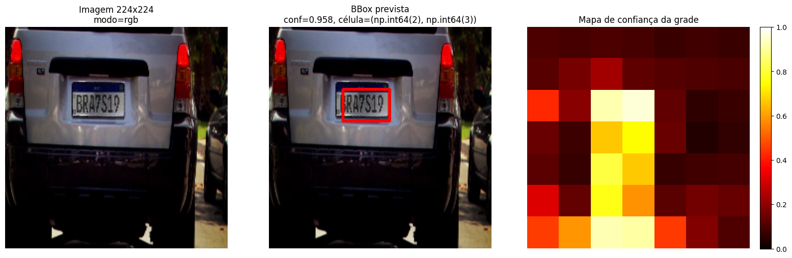
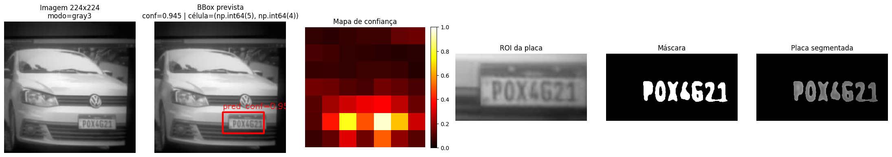

# Detecção de Placas Veiculares com MobileNet V1 e Detector por Grade

Detector leve de placas veiculares brasileiras, treinado em TensorFlow/Keras e otimizado com TensorFlow Lite (quantização INT8) para rodar em dispositivos embarcados, como o ESP32.

Projeto final da disciplina de **Processamento Digital de Imagens** do curso de Engenharia de Computação da Universidade Federal do Ceará (UFC).



## Resultados

Avaliação no conjunto de validação combinado (72 imagens das duas bases):

| Modelo | IoU médio | Recall (IoU ≥ 0,5) | Tamanho | Inferência média* |
|---|---|---|---|---|
| Keras (float32) | 0,736 | 94,4% | - | ~97 ms |
| TFLite Float32 | 0,736 | 94,4% | 8,75 MB | ~6,5 ms |
| TFLite Dynamic Range | 0,736 | 94,4% | 2,29 MB | ~7,1 ms |
| **TFLite INT8** | **0,732** | **91,7%** | **2,35 MB** | **~6,8 ms** |

Na Base 1 (60 imagens de validação), o modelo final chegou a **IoU médio de 0,77 e recall de 98,3%**.

Principais conclusões:

- A **quantização INT8 reduziu o modelo em cerca de 73%** (de 8,75 MB para 2,35 MB), com perda de apenas 0,004 no IoU médio.
- O **detector por grade generalizou melhor** que a regressão direta das coordenadas, que tendia a prever caixas próximas à posição média das placas de treino.
- O treino com **imagens negativas** (sem placa) manteve a precisão nas imagens positivas e foi usado para reduzir falsos positivos.

\*Tempo medido no ambiente do Google Colab. Serve para comparar os formatos entre si, não como medida de desempenho no ESP32.

## Como funciona

### 1. Arquitetura

A **MobileNet V1** (`alpha = 0.5`, entrada `224 × 224`), pré-treinada no ImageNet, é usada como extratora de características. Sobre ela, uma cabeça convolucional produz uma saída em grade `7 × 7 × 5`, inspirada em detectores do tipo YOLO. Cada célula prevê:

```text
[confiança, cx_local, cy_local, w, h]
```

No treino, a célula que contém o centro da placa anotada é a responsável pela detecção. Na inferência, a célula com maior confiança é usada para reconstruir a bounding box global.

### 2. Dados

- Duas bases públicas de placas veiculares do [Roboflow](https://roboflow.com/), em formato YOLOv8: Base 1 com 350 imagens de treino e 60 de validação; Base 2 com 200 de treino e 12 de validação.
- Dataset combinado de 972 imagens, com **peso maior para a Base 2** e para exemplos difíceis (placas altas ou deslocadas lateralmente), já que ela era a base com pior desempenho.
- **Data augmentation online** com Albumentations: brilho, contraste, gama, CLAHE, ruído gaussiano, desfoque (gaussiano e de movimento), perspectiva e deslocamento, escala e rotação, com as bounding boxes ajustadas junto.

### 3. Treinamento

- Treino em **duas fases**: primeiro só a cabeça do detector, com a MobileNet congelada, e depois *fine-tuning* da rede inteira com taxa de aprendizado reduzida.
- Várias execuções com seleção automática do melhor modelo por um **score balanceado** entre IoU e recall nas duas bases.

### 4. Segmentação da placa

Depois da detecção, a região da placa é recortada e segmentada com operações morfológicas do OpenCV (*black-hat*, abertura, fechamento e componentes conexos) para isolar os caracteres.



### 5. Exportação para dispositivos embarcados

O modelo final é convertido para **TensorFlow Lite** em três versões (Float32, Dynamic Range e INT8). A versão INT8 também é exportada como **header C (`.h`)** para uso com TensorFlow Lite Micro no ESP32.

## Como executar

O notebook foi feito para o **Google Colab**.

1. Abra `deteccao_placas_mobilenet_grid.ipynb` no Colab.
2. Adicione sua chave da API do Roboflow nos *Secrets* do Colab com o nome `ROBOFLOW_API_KEY`. Se ela não existir, o notebook pede a chave na hora.
3. Monte o Google Drive quando solicitado. O cache do dataset, os modelos e os resultados são salvos lá.
4. Execute as células em ordem.

Para rodar localmente, instale as dependências:

```bash
pip install -r requirements.txt
```

## Estrutura

```text
.
├── deteccao_placas_mobilenet_grid.ipynb   # notebook completo: dados, treino, avaliação, segmentação e exportação
├── assets/                                # imagens usadas neste README
├── requirements.txt
└── README.md
```

## Tecnologias

Python · TensorFlow/Keras · TensorFlow Lite · MobileNet V1 · OpenCV · Albumentations · NumPy · Pandas · scikit-learn · Roboflow

## Autor

**Victor Guedes Alves Teixeira**: [LinkedIn](https://www.linkedin.com/in/victorguedes80) · [GitHub](https://github.com/victorguedes80)
